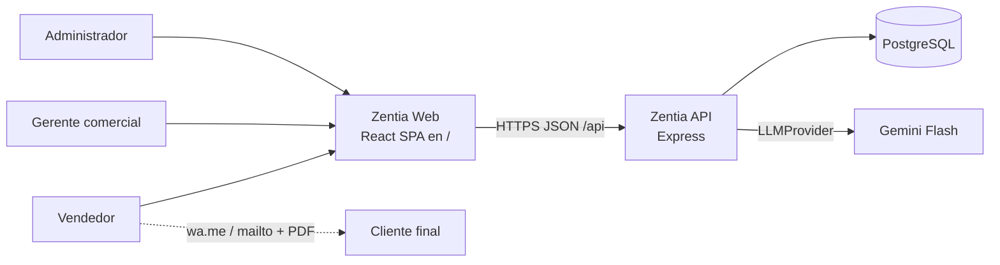
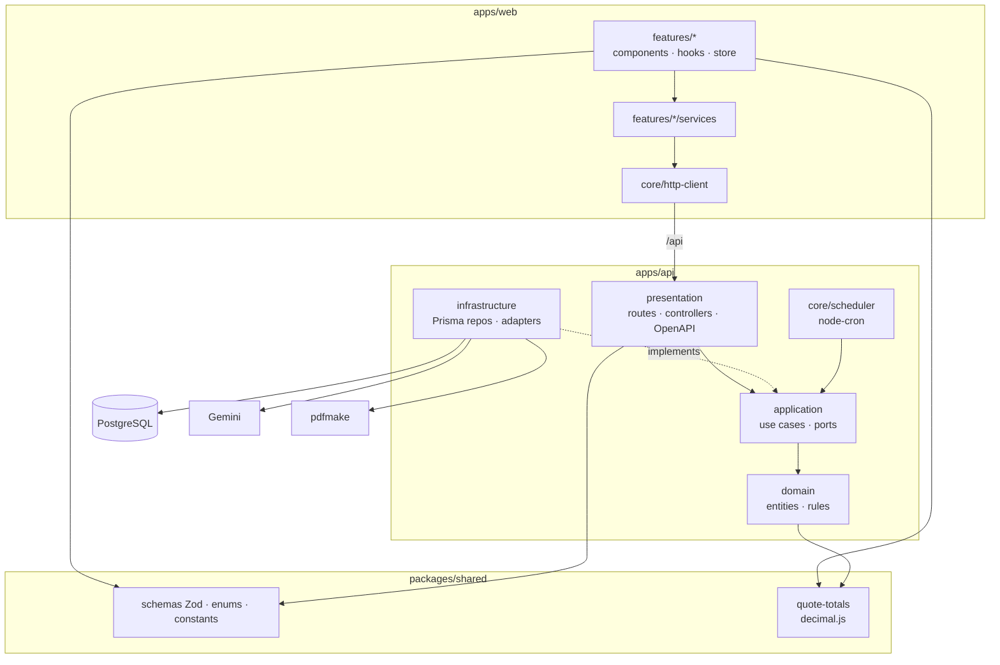
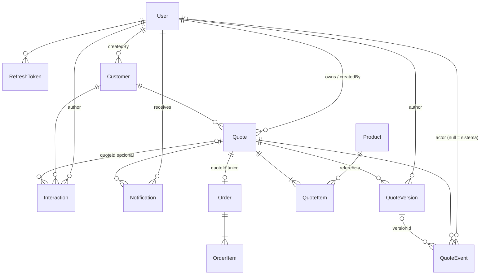
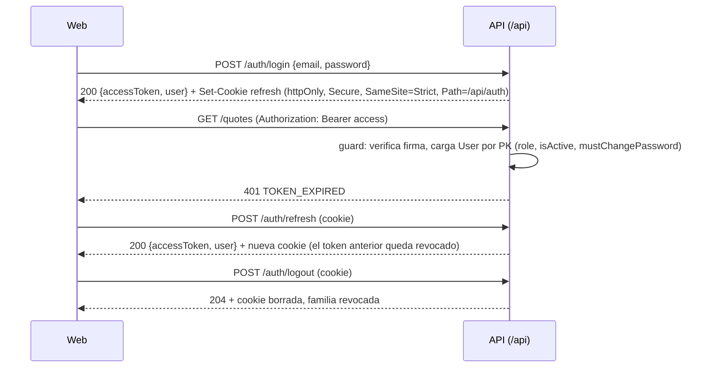

# Zentia – Architecture

> Jerarquía de fuentes: `docs/fuente/desglose.md` > `CLAUDE.md` > `docs/prd.md` > `docs/fuente/ppi-zentia.md`. Este documento no agrega requisitos. Todas las decisiones están aprobadas en `desglose.md` (decisiones 1–79).
>
> Formato de cada decisión: **Qué** · **Por qué** · *Descartado:* alternativa.
>
> **Glosario:** `fechaVencimiento` (documentos) = `expiresAt` (código).

## 1. Visión general

### Contexto

- El cliente final no usa el sistema: recibe el PDF por WhatsApp o correo desde el dispositivo del vendedor (RF-14).
- Una instalación por empresa: un despliegue equivale a una base de datos. No hay `organizationId`.
- Plataforma: Render (servicio Docker + PostgreSQL administrado); Express sirve la web en `/` y la API en `/api` (decisiones 171 y 172).
- Web y API comparten dominio; la API vive bajo `/api` (decisión 62). Las rutas citadas en este documento son relativas a `/api`.

### Componentes


## 2. Stack
| Área | Qué | Por qué | Descartado |
|---|---|---|---|
| Lenguaje | TypeScript `strict` en todo el monorepo | Un solo lenguaje y tipos compartidos entre front y back | JS + JSDoc: sin garantías en tiempo de compilación |
| Monorepo | pnpm workspaces | Enlaza `shared` sin publicar paquetes | Turborepo/Nx: tooling extra que el tamaño del proyecto no justifica |
| API | Express | Conocido por el equipo; ecosistema maduro de middlewares | NestJS: impone su propia arquitectura y se solaparía con Clean Architecture |
| ORM | Prisma | Migraciones, tipos generados, soporte de `Decimal` y `Date` | TypeORM: tipado más débil |
| BD | PostgreSQL | Transacciones, bloqueo de filas, `jsonb`, advisory locks | MySQL: menor soporte de `jsonb` y de advisory locks |
| Front | React + Vite | SPA rápida y conocida por el equipo | Next.js: el SSR no aporta en una app interna con login |
| Estado | Zustand | Estado global mínimo | Redux Toolkit: más ceremonia |
| Estilos | Tailwind v4 | Utilidades consistentes | CSS Modules: más archivos y menos consistencia |
| Validación | Zod en `shared` | Un mismo schema para front, back y OpenAPI | Joi/Yup: no generan OpenAPI |
| Dinero | `decimal.js` en `shared`; `Decimal(15,0)` en BD; decimales como `string` en la API | Precisión exacta y misma función de cálculo en front y back | `Prisma.Decimal` (no existe en el navegador); `number` en el JSON (pierde precisión) |
| Auth | `jose` + `bcryptjs` (cost 12 configurable) | Estándar, sin binarios nativos | `jsonwebtoken`; `argon2` (nativo) |
| PDF | `pdfmake` | JS puro y rápido (RNF-05); acepta el logo como data URL | Puppeteer: navegador headless pesado |
| Jobs | `node-cron`, jobs diarios | Sin infraestructura adicional en el MVP | Cola con Redis: queda como deuda (sección 8) |
| IA | `@google/genai` detrás de `LLMProvider` | Nivel gratuito por defecto; proveedor intercambiable | Servicio Python (decisión 7) |
| Logs | `pino` + `pino-http` | JSON estructurado, bajo overhead | `winston` |
| Tests | Vitest, Supertest, Testing Library | Un solo runner para front y back | Jest: configuración extra para ESM |

## 3. Monorepo
```
zentia/
├── apps/
│   ├── api/
│   │   ├── prisma/           # schema.prisma, migrations, seed
│   │   └── src/
│   │       ├── core/         # env, http (app, error handler, auth guard), logger, scheduler, openapi, prisma client
│   │       ├── lang/         # es.json, en.json (solo PDF y respaldo de IA)
│   │       ├── modules/
│   │       └── main.ts
│   └── web/
│       └── src/
│           ├── core/         # router, layout, http-client, auth store, guards, i18n
│           ├── features/
│           ├── lang/         # es.json, en.json
│           └── main.tsx
├── packages/shared/src/
│   ├── enums/  ├── schemas/  ├── calc/  ├── constants/  └── index.ts
├── docs/  ├── CLAUDE.md  └── README.md
```

**Reglas de dependencia**
| Desde | Puede importar | No puede importar |
|---|---|---|
| `apps/web` | `@zentia/shared` | `apps/api` |
| `apps/api` | `@zentia/shared` | `apps/web` |
| `packages/shared` | `zod`, `decimal.js` | `apps/*`, Prisma, Express, React |
| módulo A (api o web) | barril `index.ts` del módulo B | archivos internos de B |

- **Qué:** las reglas se hacen cumplir con la regla nativa de ESLint `no-restricted-imports`, configurada por capa (`domain` no importa `application`, `infrastructure`, `presentation` ni librerías externas; `application` no importa `infrastructure` ni `presentation`) y contra imports profundos entre módulos (solo el barril `index.ts`). **Por qué:** no requiere librerías nuevas (decisión 72). *Descartado:* `eslint-plugin-boundaries`, que no está aprobado.
- **Qué:** en `packages/shared/src/calc`, una regla de lint prohíbe `parseFloat`, `parseInt`, `Number()`, `+x` y `Math.round`; los cálculos usan `Decimal.clone()` configurado con `ROUND_HALF_UP`. **Por qué:** impide que un número de JS se cuele en el cálculo de dinero (decisión 72). *Descartado:* confiar en la revisión de código.

## 4. Arquitectura

### Módulos
| Desglose | Back `modules/` | Front `features/` |
|---|---|---|
| M1 | `auth`, `users` | `auth`, `users` |
| M2 | `company-settings` | `company-settings` |
| M3 | `customers`, `catalog` | `customers`, `catalog` |
| M4 | `quotes` | `quotes` |
| M5 | `documents` | `quotes` (acciones de PDF y envío) |
| M6 | `follow-up` (interacciones, scheduler, notificaciones) | `follow-up`, `notifications` |
| M7 | `orders` | `orders` |
| M8 | `dashboard` | `dashboard` |
| M9 | `ai` | `ai` |

### Back: Clean Architecture
- **Qué:** domain → application → infrastructure/presentation; las dependencias apuntan hacia adentro. **Por qué:** RNF-04, RNF-07 y dominio testeable sin BD. *Descartado:* capas planas controller-service-repo.
- **Qué:** las escrituras de una tabla solo las hace su módulo dueño; otros módulos llaman a sus casos de uso públicos. **Por qué:** las invariantes (estados, versiones, eventos) viven en un solo lugar. *Descartado:* escritura directa entre módulos.
- **Qué:** `dashboard`, `ai` y `follow-up` usan repositorios de solo lectura propios sobre tablas de otros módulos: viven en su `infrastructure`, solo leen y devuelven DTOs, nunca entidades de otro dominio. **Por qué:** evita N llamadas entre módulos para agregados y reglas de alertas (decisión 72). *Descartado:* queries de agregación en cada módulo dueño.
- **Qué:** puerto `UnitOfWork` (implementado con `prisma.$transaction`). **Por qué:** consecutivo, versión y evento persisten juntos (decisiones 9 y 51). *Descartado:* pasar el cliente Prisma al caso de uso.

**Ejemplo de módulo completo: `quotes`**
```
apps/api/src/modules/quotes/
├── domain/
│   ├── quote.ts                     # agregado: líneas, totales, dueño
│   ├── quote-status.ts              # máquina de estados (RN-19)
│   ├── quote-version.ts
│   ├── quote-event.ts
│   ├── quote-errors.ts              # QUOTE_NOT_FOUND, QUOTE_INVALID_TRANSITION, ...
│   └── index.ts
├── application/
│   ├── ports/
│   │   ├── quote-repository.ts
│   │   ├── quote-sequence.ts
│   │   ├── catalog-reader.ts        # productos activos y precios vigentes
│   │   ├── settings-reader.ts       # límites, vigencia, IVA del envío
│   │   ├── unit-of-work.ts
│   │   └── index.ts
│   ├── create-quote.use-case.ts
│   ├── update-quote.use-case.ts
│   ├── send-quote.use-case.ts
│   ├── change-quote-status.use-case.ts
│   ├── void-quote.use-case.ts
│   ├── reactivate-quote.use-case.ts
│   ├── duplicate-quote.use-case.ts
│   ├── change-expiry.use-case.ts
│   ├── reassign-quote.use-case.ts
│   ├── expire-quotes.use-case.ts    # invocado por el scheduler
│   ├── get-quote-history.use-case.ts
│   └── index.ts
├── infrastructure/
│   ├── prisma-quote.repository.ts
│   ├── prisma-quote-sequence.ts
│   ├── quote.mapper.ts              # Prisma.Decimal <-> decimal.js; voidReason derivado
│   └── index.ts
├── presentation/
│   ├── quotes.routes.ts
│   ├── quotes.controller.ts
│   ├── quotes.openapi.ts
│   └── index.ts
└── index.ts

apps/web/src/features/quotes/
├── components/   quote-form.tsx · quote-lines-table.tsx · quote-totals.tsx · quote-history.tsx · quote-status-badge.tsx
├── hooks/        use-quote.ts · use-quote-totals.ts (calc de shared, solo vista previa)
├── services/     quotes.service.ts
├── store/        quote-filters.store.ts
├── types/        index.ts
└── index.ts
```

### Front: organización por feature
- **Qué:** `components` → `hooks` → `services` → `core/http-client`; Zustand solo para sesión, filtros persistentes y notificaciones. **Por qué:** CLAUDE.md. *Descartado:* `fetch` desde los componentes.
- **Qué:** el access token vive solo en memoria (store de auth); al recargar la página se obtiene con `POST /auth/refresh`. **Por qué:** reduce la exposición ante XSS (decisión 62). *Descartado:* `localStorage`.
- **Qué:** `recharts` y la feature `dashboard` se cargan de forma diferida. **Por qué:** no inflar el bundle inicial.

## 5. Modelo de datos



### Entidades
Montos en `Decimal(15,0)`; cantidades `Decimal(12,2)`; porcentajes `Decimal(5,2)`; ids `uuid`; `createdAt` en todas y `updatedAt` en las mutables.

| Entidad | Campos clave | Unicidad · índices |
|---|---|---|
| `User` | email, name, passwordHash, role, isActive, mustChangePassword | `email` único |
| `RefreshToken` | userId, tokenHash, familyId, expiresAt, revokedAt?, replacedById? | `tokenHash` único; índices `userId`, `familyId` |
| `CompanySettings` | id = 1, name, taxId, address, phone, email, logoDataUrl, commercialTerms, documentLocale (`es` \| `en`), logoVersion, defaultVatRate, validityDays (15, rango 1–365), discountLimitSeller (10), discountLimitManager (30), discountLimitAdmin (30), shippingTaxable, expiringAlertDays (X = 3), followUpDays (Y = 5, rango 1–90), coldStartThreshold (30) | Fila única: PK fija `1` + `CHECK (id = 1)`; `CHECK` de X ≥ 1, Y ≥ 1, X < validityDays, umbral 30–50 |
| `Customer` | name, nameKey, documentId (normalizado, `[0-9A-Z]`, 5–20), phone (dígitos con indicativo, sin `+`), email, isActive, createdById | `documentId` único y no nulo; `CHECK (phone IS NOT NULL OR email IS NOT NULL)`; índice `name` |
| `Product` | name, nameKey, category (forma escrita), categoryKey, price (> 0), vatRate, isActive | índices `(isActive, categoryKey)`, `categoryKey` y `nameKey`; `CHECK (price > 0)` |
| `Quote` | number (`Int`), customerId, ownerId, createdById, status, discountPct, discountAmount, shippingAmount, shippingTaxable (snapshot), subtotal, linesVat, shippingVat, total, expiresAt (`DATE`), sentAt, firstSentAt, approvedAt, currentVersion | `number` único; índices `(ownerId, status)`, `(status, expiresAt)`, `firstSentAt`, `(ownerId, firstSentAt)` |
| `QuoteItem` | quoteId, productId, position, productName, category, unitPrice, vatRate, quantity, lineAmount | índice `quoteId` |
| `QuoteVersion` | quoteId, number, snapshot (`jsonb`), changes (`jsonb`), customerRequest (nulo solo en v1), authorId | `(quoteId, number)` único |
| `QuoteEvent` | quoteId, type, actorId?, versionId?, note?, data (`jsonb`) | índice `(quoteId, createdAt)` |
| `QuoteSequence` | key (`'QUOTE'`), lastValue | PK `key` |
| `Interaction` | customerId, quoteId?, type, note, occurredAt, authorId | índices `(customerId, occurredAt)`, `(quoteId, occurredAt)` |
| `Notification` | userId (dueño actual), quoteId, type, params (`jsonb`), referenceDate (`DATE` en Bogotá), readAt? | `(quoteId, type, referenceDate)` único; índice `(userId, readAt)` |
| `Order` | quoteId, status, discountPct, subtotal, discountAmount, linesVat, shippingVat, shippingAmount, total, inProgressAt, deliveredAt, cancelledAt, cancelReason, createdById (sin dueño propio: usa el de la cotización) | `quoteId` único (sin reconversión) |
| `OrderItem` | orderId, productName, category, unitPrice, vatRate, quantity, lineAmount | índice `orderId` |

**Decisiones de modelo**
- **Qué:** `Quote.number` es un `Int` único y `COT-0001` es solo formato de presentación (decisión 63). **Por qué:** permite ordenar e indexar. *Descartado:* guardar el string.
- **Qué:** el consecutivo se genera con `UPDATE "QuoteSequence" SET "lastValue" = "lastValue" + 1 WHERE key = 'QUOTE' RETURNING` dentro de la transacción. **Por qué:** el bloqueo de fila serializa las creaciones y un rollback no deja huecos. *Descartado:* `SEQUENCE` de Postgres, que deja huecos.
- **Qué:** `QuoteItem` copia nombre, categoría, precio y tarifa (RN-09). **Por qué:** snapshot; la categoría alimenta la IA. *Descartado:* leer el producto en cada consulta.
- **Qué:** `Quote` guarda `shippingTaxable` y `shippingVat` (decisión 64). **Por qué:** si el parámetro cambia, los totales históricos no cambian. *Descartado:* leer siempre el parámetro vigente.
- **Qué:** `expiresAt` es `DATE` y la cotización vale hasta el fin de ese día en `America/Bogota` (decisión 59). **Por qué:** coincide con cómo el usuario entiende "vence el día X". *Descartado:* `timestamptz` con hora exacta.
- **Qué:** `voidReason` no es columna: el mapper lo deriva de la `note` del `STATE_CHANGED` a `VOIDED` (decisión 57). *Descartado:* columna en `Quote`.
- **Qué:** al reasignar una cotización, sus notificaciones no leídas cambian de `userId` al nuevo dueño en la misma transacción del evento `REASSIGNED` (decisión 74). **Por qué:** las alertas pendientes las debe atender quien ahora es responsable. *Descartado:* dejarlas con el dueño anterior.
- **Qué:** la probabilidad de cierre se calcula al vuelo y no se persiste. **Por qué:** heurística barata y sin entidad prevista. *Descartado:* tabla de predicciones.
- **Qué:** `isActive` en `User`, `Customer` y `Product`; no hay `DELETE` de esas entidades en la API (RN-16).
- **Qué:** `category` y `documentId` se normalizan antes de guardar (función en `shared`). **Por qué:** unicidad y autocompletado confiables (decisiones 60 y 63). Las reglas exactas de normalización se definen en los tech plans de M3.

### Enums (`packages/shared/src/enums`, valores en inglés; etiquetas solo en `lang/`)
| Enum | Valores |
|---|---|
| `Role` | `SELLER`, `MANAGER`, `ADMIN` |
| `QuoteStatus` | `DRAFT`, `SENT`, `APPROVED`, `REJECTED`, `EXPIRED`, `VOIDED` |
| `OrderStatus` | `PENDING`, `IN_PROGRESS`, `DELIVERED`, `CANCELLED` |
| `VatRate` | `GENERAL_19`, `REDUCED_5`, `EXEMPT` |
| `QuoteEventType` | `DISCOUNT_OVERRIDE`, `EXPIRY_CHANGED`, `REASSIGNED`, `STATE_CHANGED` |
| `InteractionType` | `CALL`, `EMAIL`, `WHATSAPP`, `MEETING`, `OTHER` |
| `NotificationType` | `QUOTE_EXPIRING`, `QUOTE_NO_FOLLOW_UP` |
| `DocumentLocale` | `es`, `en` |

### Transporte de decimales
- **Qué:** montos, cantidades y porcentajes viajan como `string`, validados por un schema Zod compartido (regex por precisión). **Por qué:** decisión 65; nunca pasan por `number`. *Descartado:* `number` en el JSON.

## 6. Autenticación y autorización


| Decisión | Qué | Por qué | Descartado |
|---|---|---|---|
| Duración | Access JWT de 15 min en memoria, con solo `sub` (id); refresh de 7 días | Ventana corta ante robo del access token | Sesiones de servidor |
| Guard | Verifica la firma y carga el `User` por PK en cada petición; usa `role`, `isActive` y `mustChangePassword` de la BD (decisión 70) | Un cambio de rol o una desactivación aplica de inmediato | Claims de rol y estado en el token |
| Almacenamiento | Refresh opaco (32 bytes, base64url; decisión 90); `RefreshToken` guarda su SHA-256 (no el token), `familyId`, expiración, revocación y reemplazo | Revocación real por sesión y por usuario | `tokenVersion` en `User`: revoca todas las sesiones a la vez |
| Rotación | Cada refresh revoca el token usado y emite otro de la misma familia | Limita la vida útil de un token robado | Refresh fijo durante 7 días |
| Detección de reutilización | Si llega un refresh ya rotado después de la ventana de gracia de 10 s, se revoca toda la familia y se responde 401; dentro de la ventana, 409 `REFRESH_IN_PROGRESS` (decisión 91) | Señal de robo (decisión 62) | Ignorar la reutilización |
| Cookie | `httpOnly`, `Secure`, `SameSite=Strict`, `Path=/api/auth` (decisión 68) | No accesible desde JS; CSRF mitigado; solo viaja a las rutas de auth | Refresh en `localStorage` |
| Respuesta del refresh | `{ accessToken, user }` (decisión 73) | Al recargar, el front recupera la sesión y el usuario en una sola llamada | Llamada aparte a `/me` |
| Logout | Autenticado con la cookie de refresh; siempre 204 (decisión 56) | Funciona aunque el access token haya vencido; no revela el estado | Logout con access token |
| Revocación masiva | Desactivar un usuario, restablecer o cambiar su contraseña revoca todos sus refresh tokens | Corta las sesiones existentes | — |
| `mustChangePassword` | Lo lee el guard desde la BD; si es `true`, solo permite cambiar la contraseña y hacer logout | Decisiones 27 y 70 | Claim en el token; validarlo solo en el front |
| Residuo aceptado | Tras restablecer una contraseña, un access token robado sigue vivo hasta 15 min (el refresh ya está revocado); no permite tomar la cuenta porque cambiar la contraseña exige la actual (decisión 81) | Costo aceptado frente a una lista de revocación de access tokens | Lista de revocación de access tokens |
| Rate limit | Límite estricto en login (por IP + email) y límite general en las rutas públicas | RNF-03, decisión 53 | Sin límite |

### Matriz rol × permiso
| Permiso | Vendedor | Gerente | Admin |
|---|---|---|---|
| Gestionar usuarios y restablecer contraseñas | — | — | ✓ |
| Editar configuración y logo | — | — | ✓ |
| Gestionar productos | — | — | ✓ |
| Ver productos activos y autocompletar categorías | ✓ | ✓ | ✓ |
| Ver, crear y editar clientes (todos) | ✓ | ✓ | ✓ |
| Crear cotización (queda como dueño) | ✓ | ✓ | ✓ |
| Ver y editar cotizaciones | Propias | Todas | Todas |
| Límite de descuento (según el rol de quien aplica) | 10 % | 30 % | 30 % |
| Reasignar cotización | — | ✓ | ✓ |
| Cambiar vencimiento | Propias | Todas | Todas |
| Convertir a pedido y cambiar su estado | Propias | Todas | Todas |
| Registrar interacciones | ✓ | ✓ | ✓ |
| Recibir alertas (como dueño de la cotización) | Propias | Propias | Propias |
| Dashboard | Propio | Todos + filtro por vendedor | Todos + filtro por vendedor |
| Asistente IA y probabilidad | Propias | Todas | Todas |
| Cambiar mi contraseña | ✓ | ✓ | ✓ |

- **Qué:** la autorización ocurre en dos niveles: el guard de ruta valida el rol y el caso de uso valida la propiedad (`ownerId`). **Por qué:** la regla "propias vs todas" depende del dato. *Descartado:* validarlo solo en el middleware.

## 7. Convenciones transversales

**Errores**
- **Qué:** `AppError { code, status, params? }`; respuesta `{ error: { code, params?, issues? } }`; códigos `UPPER_SNAKE` en `shared/constants/error-codes.ts`. **Por qué:** el front traduce por código. *Descartado:* mensajes de texto en la respuesta.
- Los errores de Zod se mapean a `VALIDATION_ERROR` con `issues: [{ path, code }]`. Los no controlados devuelven `INTERNAL_ERROR`, se registran con el `requestId` y nunca exponen el stack.

**i18n**
- **Front:** `i18next` con `apps/web/src/lang/{es,en}.json`. Claves `errors.<CODE>`, `notifications.<TYPE>`, `enums.<Enum>.<VALUE>`, `history.actor.system`.
- **Back:** `apps/api/src/lang/{es,en}.json` solo para el PDF y el mensaje de IA (incluido el respaldo). El idioma lo define `CompanySettings.documentLocale` (por defecto `es`), no `Accept-Language` (decisión 75).
- **CI:** un test compara entre `es` y `en`, en front y back, que existan las mismas claves y los mismos marcadores (`{{...}}`) (decisión 67).

**Logging**
- **Qué:** `pino` + `pino-http` con `requestId`; `redact` sobre `authorization`, `cookie`, `password`, `logoDataUrl` y `data`. **Por qué:** trazabilidad sin filtrar secretos ni el base64 del logo. *Descartado:* `console.log`.

**Validación**
- **Qué:** schemas Zod en `shared` para el body, los params y las queries; el controller valida y el caso de uso recibe tipos ya validados. Las variables de entorno se validan con Zod al arrancar y, si fallan, el proceso no inicia. *Descartado:* validar dentro del dominio con ifs repartidos.

**OpenAPI**
- **Qué:** `@asteasolutions/zod-to-openapi` con un registro por módulo; `swagger-ui-express` en `/api/docs` solo si `DOCS_ENABLED=true` (en producción es `false` por defecto). *Descartado:* YAML escrito a mano.

**Body parser**
- El parser de `PUT /company/logo` (1 MB) se registra antes del `express.json()` global (100 KB) (decisión 49).

**Variables de entorno**
`NODE_ENV`, `DATABASE_URL`, `PORT`, `TZ=America/Bogota`, `CORS_ORIGIN`, `TRUST_PROXY=false`, `JWT_ACCESS_SECRET`, `ACCESS_TOKEN_TTL=15m`, `REFRESH_TOKEN_TTL=7d`, `BCRYPT_COST=12`, `DOCS_ENABLED`, `SCHEDULER_ENABLED`, `LOG_LEVEL`, `LLM_PROVIDER`, `LLM_MODEL`, `LLM_API_KEY`, `LLM_TIMEOUT_MS=4000`.

## 8. Puertos e integraciones
| Puerto | Contrato | Adaptador | Notas |
|---|---|---|---|
| `LLMProvider` | `generateFollowUp(input: { daysWithoutReply, approxAmount, categories[], locale }, { timeoutMs }): Promise<string>` | `GeminiProvider` | `locale` = `documentLocale`. Por tipo, el input solo admite señales estructuradas y categorías del catálogo (RN-37). Timeout de 4 s sin reintentos; ante timeout, error o 429 se usa la plantilla de respaldo (RN-38). El caso de uso reemplaza `{{CLIENTE}}` y `{{VENDEDOR}}`. |
| `PasswordHasher` | `hash(plain)`, `verify(plain, hash)` | `BcryptPasswordHasher` (cost desde `BCRYPT_COST`, por defecto 12) | Permite migrar de algoritmo sin tocar los casos de uso. |
| `TokenService` | `signAccess`, `verifyAccess`, `issueRefresh`, `rotateRefresh`, `revokeFamily`, `revokeAllForUser` | `JoseTokenService` + repositorio `RefreshToken` | Rotación y detección de reutilización. |
| `PdfRenderer` | `render(doc: QuotePdfModel, locale): Promise<Buffer>` | `PdfmakeRenderer` | Logo como data URL; textos desde `lang/` del back; `locale` = `documentLocale`. |
| `Clock` | `now()`, `today()` en `America/Bogota` | `SystemClock` (en `core/`, decisión 128) | Tests deterministas de vencimiento y alertas. |
| `UnitOfWork` | `run(fn)` | `PrismaUnitOfWork` | Agrupa consecutivo, versión y evento. |
| `Scheduler` | `register(name, cron, job)` | `NodeCronScheduler` | Ver abajo. |

**Scheduler (decisión 66)**
| Job | Horario (`America/Bogota`) | Qué hace | Idempotencia |
|---|---|---|---|
| `expire-quotes` | Diario 00:05 | `SENT` con `expiresAt < today()` pasan a `EXPIRED`, con un `STATE_CHANGED` por cotización (`actorId = null`) | Update condicional por estado |
| `follow-up-alerts` | Diario 07:00 | Crea alertas para el dueño activo de cada cotización `SENT`: "próxima a vencer" si `today() ≥ expiresAt − X` y `today() ≤ expiresAt`; "sin seguimiento" si pasaron Y días desde max(última interacción, último `sentAt`) | `INSERT ... ON CONFLICT DO NOTHING` sobre `(quoteId, type, referenceDate)` |
| Recuperación | Al arrancar | Ejecuta ambos jobs una vez para cubrir ejecuciones perdidas | Las mismas garantías |

- **Deuda de `node-cron`:** con varias instancias de la API, cada una ejecuta los jobs.
- **Mitigación sin librerías nuevas:**
  1. `SCHEDULER_ENABLED` solo en una instancia.
  2. Idempotencia por diseño.
  3. `pg_try_advisory_lock` por job.
- **Salida futura:** una cola con locks distribuidos; como requiere librerías fuera de la tabla, hay que proponerla antes (CLAUDE.md).

## 9. Pruebas
| Capa | Qué se prueba | Herramienta | Infra |
|---|---|---|---|
| `shared/calc` | RN-05 con tabla de casos: ejemplo del PPI (5.375.000), descuento y cantidad con decimales, exentos, envío gravado y no gravado, redondeo half-up por concepto | Vitest | Ninguna |
| `shared/schemas` | Decimales como `string`, normalización de `documentId` y `category`, teléfono internacional | Vitest | Ninguna |
| `domain` | Máquina de estados, límite de descuento según el rol de quien aplica, reglas de versión y evento, heurística v0 acotada a 5–95 | Vitest | Ninguna |
| `application` | Casos de uso con fakes: propiedad, `DISCOUNT_OVERRIDE` solo en Borrador, reactivación con `note`, `voidReason`, deduplicación de alertas, respaldo de la IA, rotación y reutilización de refresh | Vitest | Fakes + `Clock` fijo |
| `infrastructure` | Repositorios Prisma, consecutivo sin huecos bajo concurrencia, rollback de versión + evento, `CHECK` de `CompanySettings`, unicidad de `documentId`, `Order.quoteId` y notificaciones | Vitest | PostgreSQL de prueba (contenedor) |
| `presentation` | Rutas públicas y protegidas, rate limit, logout siempre 204, códigos de error, validación Zod, `/api/docs` deshabilitado en producción | Supertest | API + BD de prueba |
| `web` | Hooks y componentes con services simulados; formularios con los schemas de `shared` | Testing Library + Vitest | jsdom |
| i18n | Paridad de claves y marcadores entre `es` y `en`, front y back | Vitest | Ninguna |
| RNF | RNF-01, RNF-06, RNF-05 (p95) | Manual + medición | H10.2 |

El CI (H0.1) ejecuta lint, typecheck y test. Las fuentes no definen una meta de cobertura.

## 10. Riesgos técnicos
| Riesgo | Mitigación |
|---|---|
| Huecos o duplicados en el consecutivo | Contador con bloqueo de fila en la transacción; test de concurrencia |
| Jobs duplicados con varias instancias | `SCHEDULER_ENABLED`, idempotencia, advisory lock |
| Pérdida de precisión en decimales | `decimal.js` con `ROUND_HALF_UP`, transporte como `string`, mapper en infraestructura; lint que prohíbe `parseFloat`, `parseInt`, `Number()`, `+x` y `Math.round` en `shared/calc` |
| Fuga de datos personales o texto libre al LLM | Input tipado sin texto libre; tests que lo verifican |
| Límites y latencia del LLM gratuito | Timeout de 4 s, sin reintentos, respaldo por plantilla |
| Robo del refresh token | Rotación, detección de reutilización, cookie `httpOnly`/`Strict` con `Path=/api/auth` |
| Access token robado tras restablecer una contraseña | Residuo aceptado: vive hasta 15 min, sin poder cambiar la contraseña (se exige la actual). La desactivación y el cambio de rol aplican de inmediato porque el guard consulta la BD |
| Una consulta extra por petición (guard por PK) | Búsqueda por clave primaria; se mide en H10.2 junto con el p95 |
| El logo base64 infla las respuestas | `hasLogo` en el GET; logo solo por `GET /company/logo` con `Cache-Control` |
| Errores de fecha en vencimiento y alertas | `expiresAt` y `referenceDate` como `DATE`, `TZ=America/Bogota`, `Clock` inyectable |
| Dashboard lento | Índices en `firstSentAt` y `(ownerId, status)`; agregaciones en SQL |
| Claves i18n faltantes | Test de paridad de claves y marcadores en CI |

### Puntos a resolver en los tech plans (decisión 79)
| Punto | Tech plan | Qué hay que definir |
|---|---|---|
| Seed del primer administrador | M1 | Variables `ADMIN_EMAIL` y `ADMIN_PASSWORD`; el usuario se crea con `mustChangePassword = true`; comportamiento si ya existe un admin |
| Política de contraseñas | M1 | Longitud mínima y reglas de composición (la contraseña actual ya es obligatoria al cambiarla, decisión 81) |
| Refresh de la sesión actual al cambiar la propia contraseña | M1 | Se revocan los demás refresh tokens; falta decidir si el actual se conserva o se reemplaza por uno nuevo |
| `trust proxy` | M0 / M10 | Configuración de Express detrás del proxy, para que el rate limit y `Secure` usen la IP y el protocolo reales |
| Concurrencia optimista en cotizaciones | M4 | Comparar `updatedAt` en cada edición y responder con un código de conflicto si cambió |
| Fuentes de pdfmake y logo en el PDF | M5 | Fuentes embebidas (incluidos acentos), tamaño y posición del logo, comportamiento sin logo |
| `referenceDate` | M6 | Tipo `DATE` en `America/Bogota` para ambos tipos de alerta |
| Monto aproximado para la IA | M9 | Regla de aproximación (rangos o redondeo) para que el monto no identifique la cotización |
| Normalización de `documentId` y `category` | M3 | Reglas exactas (caracteres permitidos, mayúsculas, espacios, dígito de verificación) |
| Agregaciones SQL del dashboard | M8 | Consultas por indicador e índices: estado actual para activas y pendientes; `firstSentAt` para conteos de cierre, montos y conversión (RN-36) |

## 11. Pendientes de validación
Sin pendientes.
