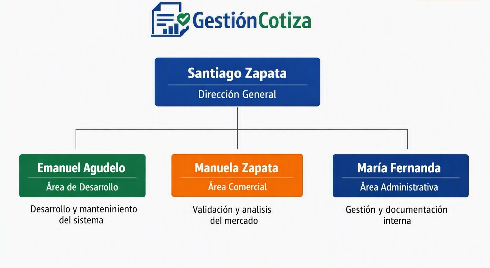
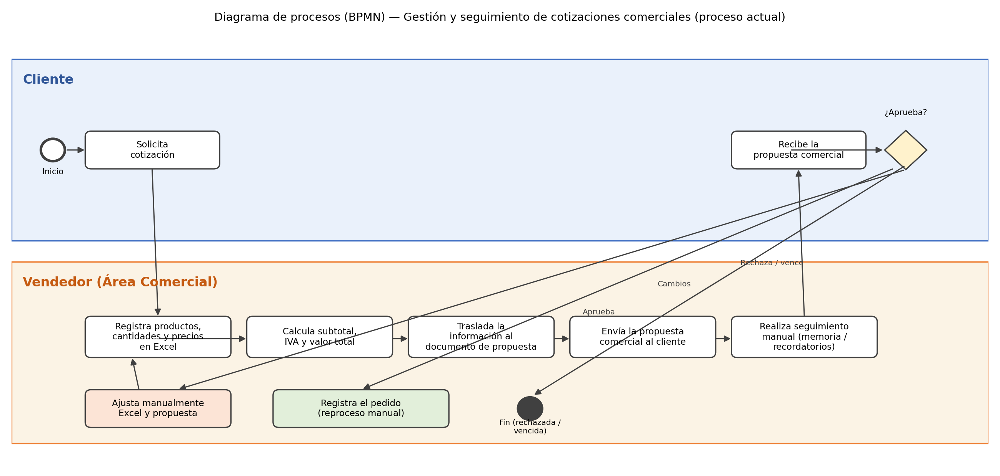
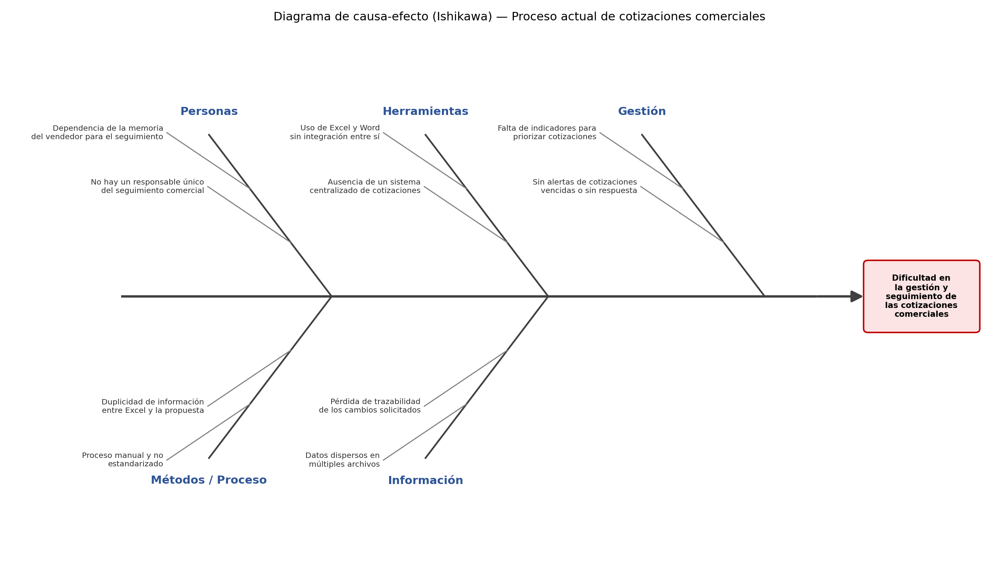
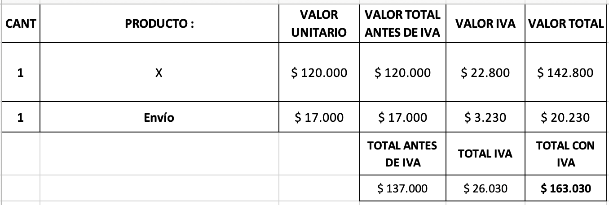
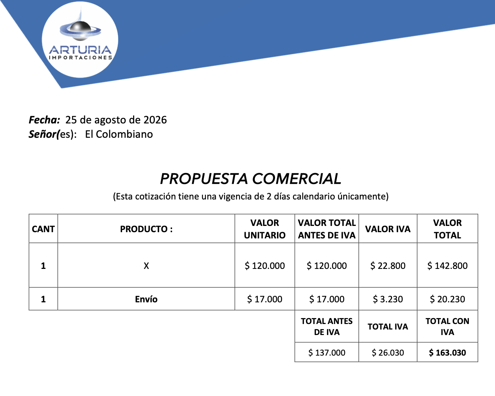

# ZENTIA – Proyecto Pedagógico Integrador (v1.7)

> Requisitos académicos originales (RF-01 a RF-14, RNF-01 a RNF-07). Convertido desde `word/Plantilla_PPI_ZENTIA_v1.7.docx`; si se modifica el Word, regenerar este archivo. Jerarquía de fuentes: `desglose.md` > `CLAUDE.md` > `prd.md` > este documento. Los ejemplos de la sección 4.3 son ilustrativos en JavaScript; las reglas de implementación están en `CLAUDE.md`.

Tecnológico de Antioquia I.U. · Técnico Profesional en Sistemas · Segundo semestre · Medellín.
Autores: María Fernanda Díaz Marín, Emmanuel Agudelo Gaviria, Manuela Camargo Zapata, Santiago Zapata.

## REGISTRO DE ACTUALIZACIONES


El registro de actualizaciones permite el control de las versiones del informe del proyecto. Cada vez que se realiza una actualización se debe registrar: la fecha, la versión que está modificando del informe, la descripción de la actualización y el integrante del equipo de trabajo que la realizó.

| Fecha | Versión | Descripción de la actualización | Autor |
| --- | --- | --- | --- |
| 21/08/2026 | 1.0 | Desarrollo inicial que involucra: integrantes, introducción y nombre del proyecto, misión y visón | Manuela Camargo |
| 24/08/2026 | 1.1 | Desarrollo de los requisitos funcionales y no funcionales | Emmanuel Agudelo Gaviria |
| 25/08/2026 | 1.2 | Actualización de la documentación del proyecto: necesidades de los stakeholders, diferenciadores clave, alcance y escalabilidad, enfoque técnico, conclusión y anexos. | Maria Fernanda Díaz |
| 10/09/2026 | 1.3 | Código de 5 requisitos funcionales | Emmanuel Agudelo Gaviria |
| 13/10/2026 | 1.4 | Ajuste de requisitos según las decisiones de alcance: nuevos RF-13 (dashboard) y RF-14 (envío de cotización); actualización de RF-01 a RF-12, RNF-01, RNF-05 y RNF-06; corrección del código de 4.3.1 a 4.3.5; restricciones de alcance (4.4) y matriz de trazabilidad (4.5). | Emmanuel Agudelo Gaviria |
| 13/10/2026 | 1.5 | Confirmaciones de alcance: estado Anulada y vigencia contada desde el envío (RF-04); límites de descuento configurables y aplicación directa por gerente o administrador (RF-02, RF-10, RF-11, RF-12); dashboard filtrado por rol (RF-13); código de 4.3.2, 4.3.3 y 4.3.5. | Emmanuel Agudelo Gaviria |
| 13/10/2026 | 1.6 | RF-12 pasa a Esencial con prioridad Alta (lo requiere RF-11) y RF-07 queda a cargo del Equipo de Backend (alertas por reglas, sin IA). Las decisiones de diseño posteriores se documentan en docs/fuente/desglose.md. | Emmanuel Agudelo Gaviria |
| 13/10/2026 | 1.7 | RF-09: en el MVP la probabilidad de cierre usa siempre la heurística por reglas; el umbral de cotizaciones cerradas solo marca cuándo calibrar o pasar a un modelo (se elimina "datos insuficientes"). | Emmanuel Agudelo Gaviria |

## INTRODUCCIÓN

En la actualidad, las pequeñas y medianas empresas (PYMES) enfrentan importantes dificultades para gestionar de manera eficiente sus procesos comerciales, en particular la elaboración, el envío y el seguimiento de las cotizaciones dirigidas a sus clientes. En la mayoría de los casos, este proceso se realiza de forma manual, apoyándose en herramientas ofimáticas como hojas de cálculo y documentos de texto que no están integradas entre sí, lo que genera duplicidad de información, pérdida de trazabilidad y demoras en la toma de decisiones comerciales.

Frente a este panorama, surge ZENTIA, un sistema de software orientado a apoyar a las PYMES en la administración de sus cotizaciones comerciales, incorporando funciones de inteligencia artificial que permiten realizar seguimiento oportuno, priorizar oportunidades de negocio y estimar la probabilidad de cierre de cada cotización. El presente documento desarrolla el proyecto pedagógico integrador de ZENTIA, presentando el contexto de la organización, el análisis del proceso actual, las necesidades identificadas en los stakeholders y la especificación de los requisitos funcionales y no funcionales que orientarán el desarrollo del sistema.

## 1. CONTEXTO DEL SISTEMA

### 1.1. Nombre de la organización

La organización se denomina ZENTIA, un sistema de software diseñado para pequeñas y medianas empresas (PYMES) que buscan mejorar la administración de sus cotizaciones comerciales con apoyo de inteligencia artificial.

### 1.2. Caracterización de la organización

ZENTIA surge como una propuesta tecnológica pensada para transformar la manera en que las pequeñas y medianas empresas gestionan sus procesos comerciales. Más que un software, se plantea como un aliado estratégico que combina simplicidad en el uso con herramientas inteligentes que facilitan la toma de decisiones.

- Actividad económica: se centra en el desarrollo de soluciones digitales que permiten a las empresas organizar, dar seguimiento y analizar sus cotizaciones de manera eficiente, reduciendo la dependencia de procesos manuales.
- Sector productivo: se ubica en el ámbito de los servicios de tecnologías de la información, con aplicación directa en la administración y gestión de ventas.
- Áreas de gestión: la organización se estructura en cuatro pilares: dirección general para la estrategia, desarrollo de software para la construcción técnica, área comercial para validar la utilidad del sistema y soporte técnico para garantizar continuidad y asistencia.
- Ubicación: aunque nace como un proyecto académico en Colombia, su diseño está orientado a responder a las necesidades de empresas latinoamericanas, adaptándose a distintos sectores y realidades.
- TIC utilizadas: combina aplicaciones web accesibles desde cualquier navegador, bases de datos relacionales que aseguran integridad de la información, inteligencia artificial aplicada al seguimiento y predicción de cierres, y servicios en la nube que garantizan disponibilidad y escalabilidad.

### 1.3. Misión

La Misión de ZENTIA es brindar a las pequeñas y medianas empresas una herramienta tecnológica accesible que facilite la administración de sus cotizaciones comerciales. El sistema busca optimizar el proceso de creación, seguimiento y análisis de propuestas, apoyando a los equipos de ventas con funciones inteligentes que mejoren la organización y aumenten las oportunidades de cierre de negocios.

### 1.4. Visión

La visión de ZENTIA es consolidarse como una plataforma líder en Latinoamérica para la gestión de cotizaciones comerciales, reconocida por su facilidad de uso, su enfoque en las necesidades de las PYMES y su capacidad de incorporar inteligencia artificial de manera práctica y transparente. Se proyecta como un sistema adaptable y en constante evolución, capaz de acompañar el crecimiento de las empresas en su proceso de transformación digital.

### 1.5. Organigrama



## 2. CONTEXTO DEL SISTEMA ACTUAL

### 2.1. Nombre del proceso organizacional

El proceso organizacional para el cual se desarrolla el sistema de información es la Gestión y seguimiento de cotizaciones comerciales, el cual hace parte del área comercial de la organización y comprende la creación, modificación, envío y seguimiento de las propuestas comerciales dirigidas a los clientes.

### 2.2. Descripción del proceso organizacional

Actualmente el proceso de gestión y seguimiento de cotizaciones comerciales se realiza de forma manual, mediante herramientas ofimáticas independientes entre sí. El responsable principal del proceso es el vendedor del área comercial, quien ejecuta las siguientes actividades:

- Entrada — Solicitud del cliente: el cliente contacta al vendedor solicitando una cotización de productos o servicios.
- Actividad — Registro en Excel: el vendedor registra en una plantilla de Microsoft Excel la información de los productos o servicios solicitados (cantidad, nombre, valor unitario y valor del envío, cuando aplica).
- Actividad — Cálculo de valores: la plantilla calcula automáticamente el valor total antes de IVA, el valor del IVA y el valor total de la cotización.
- Actividad — Elaboración de la propuesta comercial: el vendedor traslada manualmente la información calculada en Excel a un documento con formato predeterminado que constituye la propuesta comercial, incluyendo los datos del cliente, la fecha y las condiciones comerciales.
- Salida — Envío de la propuesta: el vendedor envía la propuesta comercial al cliente para su revisión.
- Actividad — Seguimiento manual: el vendedor realiza seguimiento a la cotización apoyándose en su propia memoria o en recordatorios informales, sin un mecanismo centralizado que le indique cuáles cotizaciones están pendientes, inactivas o próximas a vencer.
- Actividad — Gestión de cambios: si el cliente solicita modificaciones (productos, cantidades, precios o descuentos), el vendedor debe ajustar manualmente tanto la plantilla de Excel como el documento de propuesta.
- Salida — Cierre del proceso: si el cliente aprueba la propuesta, el vendedor registra manualmente el pedido; si la rechaza o esta vence sin respuesta, el proceso finaliza sin un registro estructurado del resultado.

### 2.3. Diagrama de procesos

A continuación se presenta el proceso organizacional actual de gestión y seguimiento de cotizaciones comerciales, modelado bajo la metodología BPMN. El diagrama relaciona a los dos stakeholders responsables de la ejecución del proceso —el cliente y el vendedor del área comercial— junto con las actividades manuales que se realizan actualmente, en el orden lógico en el que se llevan a cabo.



### 2.4. Diagrama de causa efecto

Con el fin de identificar las causas raíz de las dificultades presentes en el proceso actual de cotizaciones comerciales, se elaboró un diagrama de causa-efecto (Ishikawa), agrupando las causas en cinco categorías: personas, métodos o proceso, herramientas, información y gestión, todas ellas asociadas al efecto principal identificado: la dificultad en la gestión y seguimiento de las cotizaciones comerciales, problema que el sistema ZENTIA pretende solucionar.



## 3. NECESIDADES DE LOS STAKEHOLDERS

### 3.1. Documentación de las necesidades de los stakeholders

**REGISTRO DE LAS NECESIDADES DE LOS STAKEHOLDERS**

**Nombre de la organización: Zentia**

**Nombre del proceso: Gestión y seguimiento de cotizaciones comerciales**

**Objetivo del proceso: Gestionar de manera centralizada la creación, modificación, envío y seguimiento de cotizaciones comerciales, facilitando el control de las oportunidades de negocio y apoyando la toma de decisiones mediante información e inteligencia artificial**

| ID | Descripción breve | Solicita | Cargo | Nivel | Fecha | Prioridad |
| --- | --- | --- | --- | --- | --- | --- |
| N-01 | Disponer de información consolidada sobre el estado de las cotizaciones y el desempeño del proceso comercial para apoyar la toma de decisiones y orientar el crecimiento del proyecto. | Santiago Zapata | Dirección General | Estratégico | 25/08/2026 | Alta |
| N-02 | Contar con una solución que responda a las necesidades reales del proceso comercial y facilite la gestión y seguimiento de las cotizaciones. | Manuela Zapata | Área Comercial | Táctico | 25/08/2026 | Alta |
| N-03 | Centralizar la gestión de clientes, productos o servicios y cotizaciones, evitando la dispersión de la información en diferentes documentos o canales. | Manuela Zapata | Área Comercial | Operativo | 25/08/2026 | Alta |
| N-04 | Conocer oportunamente el estado y la situación de cada cotización para identificar oportunidades pendientes, inactivas o próximas a vencer. | Manuela Zapata | Área Comercial | Operativo | 25/08/2026 | Alta |
| N-05 | Contar con apoyo para priorizar y realizar el seguimiento de cotizaciones que presentan mayor posibilidad de cierre o requieren una acción comercial. | Manuela Zapata | Área Comercial | Operativo | 25/08/2026 | Alta |
| N-06 | Mantener la trazabilidad de los cambios realizados durante la negociación, sin necesidad de reiniciar una cotización cuando el cliente solicite modificaciones. | Manuela Zapata | Área Comercial | Operativo | 25/08/2026 | Alta |
| N-07 | Obtener información sobre el comportamiento de las cotizaciones y su probabilidad estimada de cierre para orientar mejor los esfuerzos comerciales. | Manuela Zapata | Área Comercial | Táctico | 25/08/2026 | Alta |
| N-08 | Disponer de información organizada y documentada que facilite la gestión administrativa y el control interno del proyecto. | María Fernanda | Área Administrativa | Táctico | 25/08/2026 | Media |
| N-09 | Contar con una solución técnicamente mantenible y escalable que permita incorporar nuevas funcionalidades y asegurar la evolución del sistema. | Emanuel Agudelo | Área de Desarrollo | Táctico | 25/08/2026 | Alta |

## 4. ESPECIFICACIÓN DE LOS REQUISITOS DE SOFTWARE

### 4.1. Requisitos funcionales

#### RF-01 · Gestión de clientes y catálogo de productos
Funcional · Stakeholder: Vendedor / Administrador · Esencial · Prioridad Alta · Responsable: Equipo de Backend

El sistema debe permitir registrar, editar y consultar la información de clientes (nombre, NIT o documento, contacto) y de productos o servicios (nombre, precio, categoría y tarifa de IVA: 19 %, 5 % o exento). Los clientes los gestiona el vendedor; el catálogo de productos lo gestiona el administrador.

#### RF-02 · Creación de cotizaciones con descuentos, impuestos y envío
Funcional · Stakeholder: Vendedor · Esencial · Prioridad Alta · Responsable: Equipo de Backend

El sistema debe permitir crear cotizaciones en estado Borrador, seleccionando un cliente y los productos o servicios con sus cantidades. El número consecutivo (COT-0001) lo genera el backend dentro de una transacción. Cada línea guarda el precio vigente del catálogo al momento de crearse; los cambios posteriores del catálogo no afectan las cotizaciones existentes.

Cálculo: subtotal = Σ(precio × cantidad); descuento = subtotal × d; IVA = (1 − d) × Σ(precio × cantidad × tarifa IVA del producto); total = subtotal − descuento + IVA + envío.

Descuento: global, en porcentaje sobre la cotización. El límite máximo por rol es un parámetro que configura el administrador (valores por defecto: vendedor 10 %, gerente comercial y administrador 30 %). Si el descuento requerido supera el límite del vendedor, el gerente comercial o el administrador edita la cotización directamente y el cambio queda registrado en el historial de versiones (RF-12) con el usuario que lo hizo. El flujo de solicitud y aprobación de descuentos queda para una fase 2. Se guardan siempre el porcentaje y el valor calculado. El descuento por línea queda como mejora futura.

Valor del envío: campo opcional de la cotización. Un parámetro de la empresa define si el envío grava IVA; en ese caso su IVA se suma al IVA de la cotización.

Impuestos: solo IVA, con tarifa por producto. Las retenciones quedan fuera de alcance (se aplican al facturar). Los valores monetarios se manejan con enteros o con una librería de decimales, nunca con decimales flotantes.

Las cotizaciones no se eliminan: se anulan (RF-04), para no dejar huecos en la numeración.

#### RF-03 · Generación automática de PDF
Funcional · Stakeholder: Vendedor · Esencial · Prioridad Alta · Responsable: Equipo de Backend

El sistema debe generar automáticamente un documento PDF de la cotización, utilizando una plantilla personalizable con el logo y los datos de la empresa tomados de la configuración. El PDF incluye los datos del cliente, las líneas, el descuento, el IVA, el valor del envío, el total, la fecha de vencimiento y las condiciones comerciales.

#### RF-04 · Control de estado de la cotización
Funcional · Stakeholder: Vendedor / Administrador · Esencial · Prioridad Alta · Responsable: Equipo de Backend

El sistema debe permitir cambiar y visualizar el estado de cada cotización: Borrador, Enviada, Aprobada, Rechazada, Vencida o Anulada. Toda cotización se crea en Borrador.

Transiciones permitidas: Borrador → Enviada o Anulada; Enviada → Aprobada, Rechazada, Vencida o Anulada; Vencida → Enviada (reactivación, ver RF-11). Una cotización Aprobada puede generar un pedido (RF-06). El vendedor marca manualmente la aprobación o el rechazo según la respuesta del cliente.

Vigencia: un Borrador no vence. La fecha_vencimiento se calcula (o se recalcula, al reactivar) cuando la cotización pasa a Enviada: fecha de envío + N días (N configurable, por defecto 15). El vendedor puede modificarla. El estado Vencida se asigna automáticamente al llegar esa fecha.

Anulación: se puede anular una cotización en Borrador o Enviada, registrando obligatoriamente el motivo. Anulada es un estado final: la cotización conserva su número consecutivo y no cuenta en la tasa de conversión. Una cotización Aprobada no se anula; si ya generó un pedido, se cancela el pedido (RF-06).

#### RF-05 · Registro de observaciones por cliente
Funcional · Stakeholder: Vendedor · Deseable · Prioridad Media · Responsable: Equipo de Backend

El sistema debe permitir registrar observaciones y mantener un historial de interacciones con cada cliente (fecha, tipo de contacto y nota), asociándolas cuando aplique a una cotización. La fecha de la última interacción se usa para las alertas de seguimiento (RF-07).

#### RF-06 · Conversión de cotización a pedido
Funcional · Stakeholder: Vendedor / Administrador · Esencial · Prioridad Alta · Responsable: Equipo de Backend

El sistema debe convertir una cotización Aprobada en un pedido, copiando sus líneas y valores (snapshot) para evitar el reproceso manual de la información. Estados del pedido: Pendiente → En proceso → Entregado, o Cancelado.

El pedido no mueve inventario ni genera factura; esas funciones corresponden al sistema contable o ERP de la empresa.

#### RF-07 · Alertas de cotizaciones vencidas o sin seguimiento
Funcional · Stakeholder: Vendedor · Esencial · Prioridad Alta · Responsable: Equipo de Backend

El sistema debe generar alertas automáticas, mediante reglas, para: (a) cotizaciones próximas a vencer, X días antes de su fecha de vencimiento; y (b) cotizaciones sin seguimiento, Y días después de la última interacción registrada (RF-05) o, si no hay interacciones, desde el envío. X e Y son configurables.

Las alertas se muestran dentro de la aplicación (campana y sección de notificaciones). El envío por correo queda para una fase 2 y no se usan notificaciones push. Cuando exista RF-09, las alertas se ordenan por probabilidad de cierre.

#### RF-08 · Asistente de seguimiento con IA
Funcional · Stakeholder: Vendedor · Esencial · Prioridad Alta · Responsable: Equipo de IA

El sistema debe sugerir o redactar automáticamente un mensaje de seguimiento cuando una cotización lleve varios días sin respuesta del cliente. El vendedor puede editar el mensaje antes de usarlo.

El proveedor de IA es configurable mediante una interfaz LLMProvider y variables de entorno (proveedor, modelo, API key); por defecto se usa Gemini Flash en su nivel gratuito. No se envían datos personales (nombres, NIT, teléfonos): solo la información necesaria y anonimizada. Con clientes reales se debe pasar a un nivel de pago.

Si el proveedor falla, supera el tiempo límite (RNF-05) o alcanza el límite de peticiones, el sistema muestra un mensaje de respaldo basado en plantilla.

#### RF-09 · Predicción de probabilidad de cierre
Funcional · Stakeholder: Vendedor / Gerente comercial · Deseable · Prioridad Media · Responsable: Equipo de IA

El sistema debe calcular y mostrar la probabilidad estimada de que una cotización Enviada sea aprobada, usando solo señales estructuradas (conteos y fechas) de cotizaciones, versiones e interacciones.

En el MVP se usa siempre una heurística por reglas, rotulada "estimación por reglas". El umbral de cotizaciones cerradas (parámetro, por defecto 30, rango 30–50) solo indica cuándo se podrá calibrar la heurística o pasar a un modelo en una fase 2. Los datos sintéticos se usan solo para pruebas y demostración del prototipo, declarándolo explícitamente, y nunca en producción real.

#### RF-10 · Gestión de usuarios y roles
Funcional · Stakeholder: Administrador · Esencial · Prioridad Alta · Responsable: Equipo de Backend

El sistema debe permitir gestionar usuarios con tres roles: (1) Vendedor: ve y edita solo sus propias cotizaciones; (2) Gerente comercial: ve y gestiona todas las cotizaciones (incluida la aplicación de descuentos superiores al límite del vendedor), pero no administra usuarios; (3) Administrador: gestiona usuarios, productos y parámetros de la empresa, y también puede gestionar todas las cotizaciones.

El dashboard (RF-13) y la predicción de cierre (RF-09) se muestran a todos los roles, filtrados según el alcance de cada uno.

#### RF-11 · Edición de cotizaciones pendientes
Funcional · Stakeholder: Vendedor · Esencial · Prioridad Alta · Responsable: Equipo de Backend

El sistema debe permitir editar una cotización pendiente (agregar, quitar o modificar productos, cantidades o descuentos) sin necesidad de crearla nuevamente desde cero. Se considera pendiente una cotización en estado Borrador o Enviada. El vendedor edita sus propias cotizaciones; el gerente comercial y el administrador pueden editar cualquiera.

Editar una cotización Enviada no la devuelve a Borrador: conserva su estado y genera una nueva versión (RF-12). Al editar es obligatorio registrar qué solicitó el cliente.

Una cotización Vencida puede reactivarse: se crea una nueva versión, vuelve a Enviada con una nueva vigencia contada desde el reenvío y el sistema ofrece actualizar los precios con el catálogo vigente. Las cotizaciones Aprobadas, Rechazadas o Anuladas no son editables; para las dos primeras se usa la opción "duplicar", que crea una cotización nueva.

#### RF-12 · Historial de versiones de la cotización
Funcional · Stakeholder: Vendedor / Administrador · Esencial · Prioridad Alta · Responsable: Equipo de Backend / Equipo de IA

El sistema debe conservar un historial de versiones de cada cotización editada o reactivada, registrando qué cambió, cuándo, el usuario que hizo el cambio y qué solicitó el cliente (campo de texto obligatorio). Esto incluye los descuentos aplicados por el gerente comercial o el administrador por encima del límite del vendedor. El historial sirve como fuente de datos para alimentar los modelos de inteligencia artificial (RF-09).

#### RF-13 · Dashboard comercial
Funcional · Stakeholder: Vendedor / Gerente comercial / Administrador · Esencial · Prioridad Alta · Responsable: Equipo de Backend / Equipo de Frontend

El sistema debe mostrar un dashboard con indicadores del proceso comercial: número de cotizaciones activas, aprobadas, rechazadas, vencidas y pendientes de seguimiento; montos cotizados frente a montos aprobados; tasa de conversión (sin contar las cotizaciones anuladas); y oportunidades con mayor probabilidad de cierre (RF-09).

Es una sola pantalla con datos filtrados por rol: el vendedor ve los indicadores de sus propias cotizaciones; el gerente comercial y el administrador ven todas, con filtro por vendedor. Todos pueden filtrar por período. Este requisito responde a las necesidades N-01 y N-07 y a la pregunta 10 de la entrevista (Anexo 1).

#### RF-14 · Envío de la cotización al cliente
Funcional · Stakeholder: Vendedor · Esencial · Prioridad Alta · Responsable: Equipo de Backend / Equipo de Frontend

El sistema debe apoyar el envío de la cotización al cliente. En el MVP el vendedor descarga el PDF (RF-03) y el sistema ofrece dos accesos: "Abrir en WhatsApp" (enlace wa.me con un mensaje prellenado) y "Abrir en correo" (enlace mailto). Al usar cualquiera de ellos, la cotización pasa al estado Enviada (RF-04).

El envío automático por SMTP o por la API de WhatsApp queda para una fase 2.

### 4.2. Requisitos no funcionales

#### RNF-01 · Usabilidad de la interfaz
No funcional · Stakeholder: Vendedor · Esencial · Prioridad Alta · Responsable: Equipo de Frontend

La interfaz del sistema debe ser simple e intuitiva, utilizable por personal sin formación técnica en menos de 30 minutos de familiarización.

Criterio de verificación: prueba con 3 a 5 usuarios sin formación técnica; tras 30 minutos de familiarización deben crear una cotización, generar el PDF y cambiar su estado sin ayuda. Meta: al menos 80 % de éxito.

#### RNF-02 · Disponibilidad del sistema
No funcional · Stakeholder: Administrador · Esencial · Prioridad Alta · Responsable: Equipo de Infraestructura

El sistema debe estar disponible vía web, accesible desde cualquier navegador, sin requerir instalación local.

#### RNF-03 · Seguridad y control de acceso
No funcional · Stakeholder: Administrador · Esencial · Prioridad Alta · Responsable: Equipo de Backend

El sistema debe contar con autenticación de usuarios y control de acceso por rol, protegiendo la información de clientes y cotizaciones.

#### RNF-04 · Escalabilidad de la arquitectura
No funcional · Stakeholder: Administrador · Deseable · Prioridad Media · Responsable: Equipo de Backend

La arquitectura del sistema debe permitir agregar nuevos módulos (bodegas, sucursales) sin necesidad de rediseñar el sistema completo.

#### RNF-05 · Rendimiento de generación de documentos y respuestas de IA
No funcional · Stakeholder: Vendedor · Esencial · Prioridad Alta · Responsable: Equipo de Backend / IA

La generación de PDF y las respuestas del asistente de IA deben completarse en menos de 5 segundos en el percentil 95, usando mensajes cortos.

Las llamadas al proveedor de IA tienen un tiempo límite; si se supera, si el proveedor falla o si se alcanza el límite de peticiones del nivel gratuito, se muestra un mensaje de respaldo.

#### RNF-06 · Portabilidad entre navegadores
No funcional · Stakeholder: Vendedor · Deseable · Prioridad Media · Responsable: Equipo de Frontend

El sistema debe ser compatible con los navegadores web más utilizados, sin depender de un sistema operativo específico.

Criterio de verificación: funciona en las dos últimas versiones de Chrome, Edge, Firefox y Safari, verificado con una lista de flujos críticos (crear cotización, generar PDF, cambiar estado) en cada navegador.

#### RNF-07 · Mantenibilidad del código
No funcional · Stakeholder: Equipo de desarrollo · Deseable · Prioridad Media · Responsable: Equipo de desarrollo

El código del sistema debe estar organizado de forma modular, permitiendo que distintos integrantes del equipo trabajen en paralelo sin conflictos significativos.

### 4.3. Representación de los requisitos en un lenguaje de programación

#### 4.3.1. RF-01: Gestión de clientes y catálogo de productos

```js
// RF-01: Gestión de clientes y catálogo de productos

class Cliente {
    constructor(nombre, contacto) {
        this.nombre = nombre;
        this.contacto = contacto;
    }
}

class Producto {
    // tarifaIva: "GENERAL" (19 %), "REDUCIDA" (5 %) o "EXENTO"
    constructor(nombre, precio, categoria, tarifaIva = "GENERAL") {
        this.nombre = nombre;
        this.precio = precio; // pesos enteros
        this.categoria = categoria;
        this.tarifaIva = tarifaIva;
    }
}

const cliente = new Cliente(
    "Juan Pérez",
    "3001234567"
);

const producto = new Producto(
    "Computador portátil",
    2500000,
    "Tecnología"
);
```

#### 4.3.2. RF-02: Creación de cotizaciones con descuentos e impuestos

```js
// RF-02: Creación de cotizaciones con descuentos, IVA por producto y envío
// Los valores monetarios se manejan en pesos enteros (sin decimales flotantes).

const TARIFAS_IVA = { GENERAL: 0.19, REDUCIDA: 0.05, EXENTO: 0 };

// Parámetros de la empresa que configura el administrador (valores por defecto)
const config = {
    diasVigencia: 15,
    envioGravaIva: false,
    limitesDescuento: { vendedor: 0.10, gerente: 0.30, administrador: 0.30 }
};

function calcularTotales(lineas, porcentajeDescuento, envio, envioGravaIva) {
    const subtotal = lineas.reduce(
        (total, linea) => total + linea.precio * linea.cantidad,
        0
    );
    const ivaLineas = lineas.reduce(
        (total, linea) =>
            total + linea.precio * linea.cantidad * TARIFAS_IVA[linea.tarifaIva],
        0
    );
    const descuento = Math.round(subtotal * porcentajeDescuento);
    let iva = Math.round((1 - porcentajeDescuento) * ivaLineas);
    if (envioGravaIva) {
        iva += Math.round(envio * TARIFAS_IVA.GENERAL);
    }
    const total = subtotal - descuento + iva + envio;
    return { subtotal, porcentajeDescuento, descuento, iva, envio, total };
}

function validarDescuento(usuario, porcentajeDescuento) {
    if (porcentajeDescuento > config.limitesDescuento[usuario.rol]) {
        throw new Error(
            "El descuento supera el límite del rol: debe aplicarlo " +
            "un gerente comercial o un administrador"
        );
    }
}

function crearCotizacion(usuario, cliente, lineas, porcentajeDescuento = 0, envio = 0) {
    validarDescuento(usuario, porcentajeDescuento);
    return {
        numero: null, // COT-0001: lo asigna el backend dentro de una transacción
        vendedor: usuario.nombre,
        cliente,
        lineas: lineas.map(linea => ({ ...linea })), // precio vigente al crear
        ...calcularTotales(lineas, porcentajeDescuento, envio, config.envioGravaIva),
        fechaCreacion: new Date(),
        fechaVencimiento: null, // se calcula al pasar a Enviada (RF-04)
        estado: "borrador"
    };
}

const cotizacion = crearCotizacion(
    { nombre: "Ana Ruiz", rol: "vendedor" },
    cliente,
    [{
        producto: producto.nombre,
        precio: producto.precio,
        tarifaIva: producto.tarifaIva,
        cantidad: 2
    }],
    0.10,
    20000
);

console.log(cotizacion.total); // 5375000
```

#### 4.3.3. RF-04: Control de estado de la cotización

```js
// RF-04: Control de estado de la cotización

const TRANSICIONES = {
    borrador: ["enviada", "anulada"],
    enviada: ["aprobada", "rechazada", "vencida", "anulada"],
    vencida: ["enviada"], // reactivación: nueva versión y nueva vigencia (RF-11)
    aprobada: [],          // puede generar un pedido (RF-06)
    rechazada: [],
    anulada: []            // estado final: conserva su número consecutivo
};

function cambiarEstadoCotizacion(cotizacion, nuevoEstado, motivo = "") {
    const permitidos = TRANSICIONES[cotizacion.estado] || [];
    if (!permitidos.includes(nuevoEstado)) {
        throw new Error(
            `Transición no válida: ${cotizacion.estado} -> ${nuevoEstado}`
        );
    }
    if (nuevoEstado === "anulada") {
        if (!motivo.trim()) {
            throw new Error("La anulación requiere un motivo");
        }
        cotizacion.motivoAnulacion = motivo;
    }
    if (nuevoEstado === "enviada") {
        // La vigencia se cuenta desde el envío (también al reactivar)
        cotizacion.fechaEnvio = new Date();
        cotizacion.fechaVencimiento = new Date(cotizacion.fechaEnvio);
        cotizacion.fechaVencimiento.setDate(
            cotizacion.fechaVencimiento.getDate() + config.diasVigencia
        );
    }
    cotizacion.estado = nuevoEstado;
    return cotizacion;
}

// Solo una cotización Enviada vence; un Borrador no vence
function actualizarVencimiento(cotizacion, hoy = new Date()) {
    if (cotizacion.estado === "enviada" && hoy >= cotizacion.fechaVencimiento) {
        cambiarEstadoCotizacion(cotizacion, "vencida");
    }
    return cotizacion;
}

cambiarEstadoCotizacion(cotizacion, "enviada"); // fija la fecha de vencimiento
cambiarEstadoCotizacion(cotizacion, "aprobada");
console.log(cotizacion.estado); // "aprobada"
```

#### 4.3.4. RF-06: Conversión de cotización a pedido

```js
// RF-06: Conversión de cotización a pedido

function convertirAPedido(cotizacion) {
    if (cotizacion.estado !== "aprobada") {
        throw new Error(
            "Solo se pueden convertir cotizaciones aprobadas"
        );
    }

    return {
        cotizacion: cotizacion.numero,
        cliente: cotizacion.cliente,
        lineas: cotizacion.lineas.map(linea => ({ ...linea })), // snapshot
        total: cotizacion.total,
        fecha: new Date(),
        estado: "pendiente" // pendiente -> en proceso -> entregado | cancelado
    };
}

const pedido = convertirAPedido(cotizacion);
console.log(pedido);
```

#### 4.3.5. RF-10: Gestión de usuarios y roles

```js
// RF-10: Gestión de usuarios y roles

const PERMISOS = {
    vendedor: ["cotizaciones:propias"],
    gerente: ["cotizaciones:todas"],
    administrador: ["cotizaciones:todas", "usuarios", "productos", "parametros"]
};

class Usuario {
    constructor(nombre, rol) {
        if (!PERMISOS[rol]) {
            throw new Error("Rol no válido");
        }
        this.nombre = nombre;
        this.rol = rol;
    }

    tienePermiso(permiso) {
        return PERMISOS[this.rol].includes(permiso);
    }

    puedeGestionarUsuarios() {
        return this.tienePermiso("usuarios");
    }

    // Gerente comercial y administrador gestionan todas las cotizaciones
    // (por ejemplo, aplicar un descuento superior al límite del vendedor)
    puedeGestionarCotizaciones() {
        return this.tienePermiso("cotizaciones:todas");
    }

    puedeEditarCotizacion(cotizacion) {
        return this.puedeGestionarCotizaciones() ||
            cotizacion.vendedor === this.nombre;
    }

    // RF-13: una sola pantalla de dashboard, filtrada por rol
    filtrarParaDashboard(cotizaciones) {
        return this.puedeGestionarCotizaciones()
            ? cotizaciones
            : cotizaciones.filter(c => c.vendedor === this.nombre);
    }
}

const gerente = new Usuario("Carlos Gómez", "gerente");
console.log(gerente.puedeGestionarUsuarios());         // false
console.log(gerente.puedeGestionarCotizaciones());     // true
console.log(gerente.puedeEditarCotizacion(cotizacion)); // true
```

### 4.4. Restricciones de alcance y decisiones de diseño

A continuación se documentan las restricciones de alcance y las decisiones tomadas para resolver los vacíos identificados en la especificación de requisitos.

Instalación por empresa: ZENTIA se despliega como una instalación independiente por empresa; no es un SaaS multiempresa y no usa identificador de inquilino (tenant_id). Los datos propios de la empresa (logo, datos de contacto, IVA por defecto, días de vigencia, límites de descuento, parámetro de IVA del envío, días X e Y de las alertas) se guardan en una configuración.

Sin portal para el cliente: el cliente no accede al sistema; solo recibe el PDF. El vendedor registra manualmente la aprobación o el rechazo. Un portal del cliente queda como mejora futura.

Envío asistido: en el MVP el envío se hace con enlaces wa.me y mailto (RF-14). El envío automático por SMTP o por la API de WhatsApp queda para una fase 2.

Descuentos e impuestos: solo descuento global en porcentaje (el descuento por línea es mejora futura) y solo IVA por producto. Los límites de descuento por rol son parámetros configurables. No hay flujo de solicitud y aprobación de descuentos: el gerente comercial o el administrador aplica directamente los descuentos que superan el límite del vendedor (fase 2: flujo de aprobación). Las retenciones se aplican al facturar, fuera del sistema.

Pedidos: no mueven inventario ni generan facturas; esas funciones corresponden al sistema contable o ERP de la empresa. Bodegas y sucursales (RNF-04) se mantienen como requisito de extensibilidad de la arquitectura, sin RF por ahora.

Alertas: solo dentro de la aplicación; el correo es opcional en una fase 2 y no hay notificaciones push.

Inteligencia artificial: el proveedor de LLM es configurable (por defecto Gemini Flash, nivel gratuito). Como en el nivel gratuito el proveedor puede usar los datos enviados para mejorar sus productos (se deben verificar los términos vigentes), no se envían datos personales y, con clientes reales, se debe pasar a un nivel de pago. La predicción de cierre usa una heurística hasta contar con 30 a 50 cotizaciones cerradas; los datos sintéticos se usan solo para pruebas y demostración.

Tecnología: el stack no es obligatorio; los ejemplos de la sección 4.3 en JavaScript son ilustrativos. Se mantienen las restricciones de la sección 1.2: aplicación web accesible desde el navegador, base de datos relacional, despliegue en la nube e inteligencia artificial. Propuesta: TypeScript/Node.js, PostgreSQL y React, con el componente de IA como servicio aparte (por ejemplo, en Python).

### 4.5. Matriz de trazabilidad

La siguiente matriz relaciona cada necesidad de los stakeholders con los requisitos que la satisfacen.

| Necesidad | Descripción breve | Requisitos que la cubren |
| --- | --- | --- |
| N-01 | Información consolidada para la toma de decisiones | RF-04, RF-13 |
| N-02 | Solución acorde al proceso comercial real | RF-01 a RF-14 (en conjunto) |
| N-03 | Centralizar clientes, productos y cotizaciones | RF-01, RF-02, RF-03, RF-05, RF-06, RF-14 |
| N-04 | Conocer el estado de cada cotización | RF-04, RF-07, RF-13 |
| N-05 | Apoyo para priorizar y hacer seguimiento | RF-07, RF-08, RF-09 |
| N-06 | Trazabilidad de cambios sin reiniciar la cotización | RF-11, RF-12 |
| N-07 | Comportamiento y probabilidad de cierre | RF-09, RF-13 |
| N-08 | Información organizada para la gestión administrativa del proyecto | No requiere RF: cubierto por la documentación del proyecto |
| N-09 | Solución mantenible y escalable | RF-10, RNF-03, RNF-04, RNF-07 |

## ANEXOS

### Anexo 1: Entrevista

Stakeholder entrevistado: Manuela Zapata · Área: Comercial · Fecha: 25 de agosto de 2026

1. ¿Cómo se realiza actualmente el proceso de elaboración y gestión de las cotizaciones comerciales?

Respuesta: Actualmente, la elaboración y gestión de las cotizaciones puede realizarse mediante diferentes herramientas y documentos, como plantillas de cálculo y documentos de texto. Esto dificulta centralizar la información y tener una visión completa de las cotizaciones que se encuentran activas, pendientes o finalizadas.

2. ¿Qué dificultades se presentan durante el seguimiento de las cotizaciones enviadas a los clientes?

Respuesta: Una de las principales dificultades es realizar un seguimiento oportuno a todas las cotizaciones. El seguimiento puede depender de recordar qué clientes requieren una respuesta, lo que aumenta la posibilidad de que algunas oportunidades queden sin atención.

3. ¿Cómo se identifica actualmente cuáles cotizaciones requieren seguimiento?

Respuesta: La identificación se realiza principalmente mediante la revisión manual de las cotizaciones y la información disponible. No siempre existe un mecanismo centralizado que permita identificar de forma inmediata cuáles cotizaciones se encuentran sin respuesta o requieren seguimiento.

4. ¿Qué ocurre cuando un cliente solicita realizar cambios en una cotización?

Respuesta: Cuando el cliente solicita modificar productos, cantidades, precios o descuentos, es necesario realizar ajustes en la cotización. Actualmente, estas modificaciones pueden requerir cambios manuales en los documentos utilizados, especialmente cuando la cotización incluye varios productos.

5. ¿Qué información considera importante para conocer la situación de una cotización?

Respuesta: Es importante conocer el cliente asociado, los productos o servicios cotizados, el valor de la cotización, la fecha de creación, su estado y la última interacción realizada. Esta información permite tener un mayor control sobre cada oportunidad comercial.

6. ¿Considera útil recibir alertas sobre cotizaciones pendientes o sin respuesta? ¿Por qué?

Respuesta: Sí. Las alertas permitirían identificar de manera más rápida las cotizaciones que requieren una acción comercial y reducirían la posibilidad de perder oportunidades por falta de seguimiento oportuno.

7. ¿Qué tipo de apoyo podría ofrecer la inteligencia artificial dentro del proceso comercial?

Respuesta: La inteligencia artificial podría apoyar el proceso mediante la identificación de cotizaciones que requieren seguimiento, la generación de sugerencias para el contacto con los clientes y el análisis de la información disponible para estimar cuáles oportunidades presentan una mayor probabilidad de cierre.

8. ¿Considera útil conocer la probabilidad de cierre de una cotización?

Respuesta: Sí. Contar con una estimación de la probabilidad de cierre permitiría priorizar los esfuerzos comerciales y dedicar mayor atención a las oportunidades que presentan mejores posibilidades de convertirse en una venta.

9. ¿Qué información debería conservarse sobre los cambios realizados durante una negociación?

Respuesta: Debería conservarse información sobre los cambios solicitados por el cliente, como modificaciones de productos, cantidades, precios o descuentos. Esto permitiría mantener un historial de la cotización y conocer cómo ha evolucionado durante la negociación.

10. ¿Qué información considera importante visualizar en un dashboard comercial?

Respuesta: Sería importante visualizar el número de cotizaciones activas, aprobadas, rechazadas, vencidas y pendientes de seguimiento. También sería útil conocer los montos cotizados, las oportunidades con mayor probabilidad de cierre y otros indicadores que faciliten la toma de decisiones.

11. ¿Qué espera de una solución para la gestión y seguimiento de cotizaciones?

Respuesta: Se espera una solución que permita centralizar la información, facilitar la creación y modificación de cotizaciones, realizar seguimiento oportuno y proporcionar información útil para apoyar la gestión comercial y la toma de decisiones.

### Anexo 2: Documentación del sistema actual

DOCUMENTACIÓN DEL PROCESO ACTUAL DE COTIZACIÓN

Para comprender el funcionamiento de los procesos de cotización comerciales que actualmente utilizan diferentes pequeñas y medianas empresas, se tomó como referencia un ejemplo de elaboración de cotizaciones realizado mediante herramientas ofimáticas.

Este ejemplo no corresponde a la implementación de una solución para una empresa específica, sino que se utiliza como referencia para representar un proceso común en diversas pymes que actualmente realizan la creación y gestión de sus cotizaciones de forma manual.

En este tipo de procesos, la información de los productos y sus valores suele registrarse inicialmente en una plantilla de cálculo. Posteriormente, dicha información es transferida manualmente a un documento destinado a presentar la propuesta comercial al cliente.

A continuación, se presenta un ejemplo de los documentos utilizados durante este proceso:

Documento 1. Elaboración de la cotización en Microsoft Excel

El proceso de elaboración de la cotización inicia con el uso de una plantilla de Microsoft Excel previamente establecida.

En este documento se registra la información correspondiente a los productos o servicios solicitados por el cliente, incluyendo la cantidad, el nombre del producto, el valor unitario y el valor correspondiente al envío, cuando aplica.

Asimismo, la plantilla permite calcular automáticamente el valor total antes de IVA, el valor del IVA y el valor total de la cotización.

Este documento sirve como herramienta inicial para organizar la información y realizar los cálculos necesarios antes de generar la propuesta comercial.

Figura 1. Ejemplo de elaboración de una cotización en Microsoft Excel.



Documento 2. Generación de la propuesta comercial

Después de realizar los cálculos en la plantilla de Excel, la información de la cotización es copiada manualmente y trasladada a un documento con un formato predeterminado para generar la propuesta comercial que será presentada al cliente.

Este documento contiene la información relacionada con los productos o servicios cotizados, las cantidades, los valores unitarios, el IVA, el valor del envío y el valor total de la cotización.

Adicionalmente, puede incluir información complementaria, como la fecha de elaboración, los datos del cliente y las condiciones comerciales aplicables.

Una vez completada la información, el documento constituye la propuesta comercial final que puede ser enviada al cliente.

Figura 2. Ejemplo de propuesta comercial generada a partir de la información registrada en la cotización.



Análisis del proceso actual

El ejemplo presentado permite identificar un proceso de elaboración de cotizaciones que puede encontrarse en diferentes pequeñas y medianas empresas.

Actualmente, la información de los productos, precios y envío se registra en una herramienta como Excel y posteriormente debe transferirse manualmente a otro documento para generar la propuesta comercial. Este proceso puede generar duplicidad de información, posibles errores durante la transferencia de datos y mayor tiempo en la elaboración de las cotizaciones.

Además, la información no siempre queda almacenada de forma centralizada. Si un cliente, días después, desea realizar la compra, solicitar cambios o agregar nuevos productos, puede ser necesario buscar la cotización anterior y realizar nuevamente las modificaciones. Cuando existen cambios en los precios, el proceso también debe actualizarse manualmente.

Por otra parte, después de enviar la cotización no existe un seguimiento estructurado que permita conocer fácilmente su estado o identificar cuáles requieren una nueva interacción. Esto puede dificultar el control de las oportunidades comerciales.

A partir de esta situación, se identifica la necesidad de contar con una solución que permita centralizar la creación, almacenamiento, modificación y seguimiento de las cotizaciones comerciales, reduciendo la dependencia de diferentes documentos y facilitando la gestión de las oportunidades comerciales.

